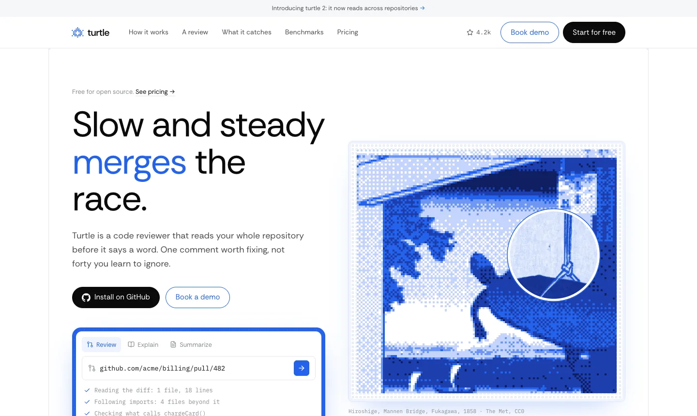
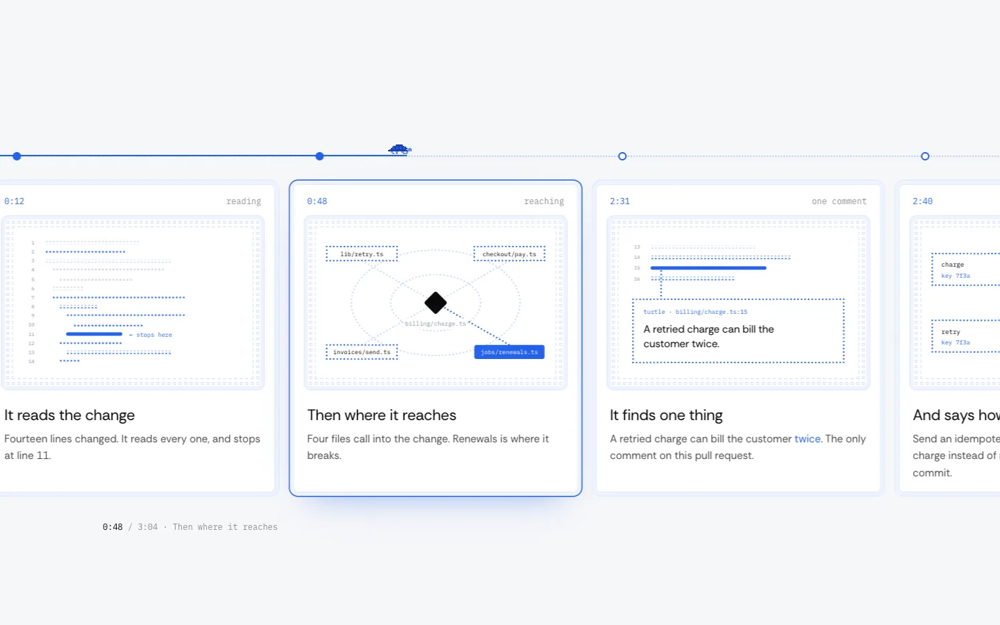
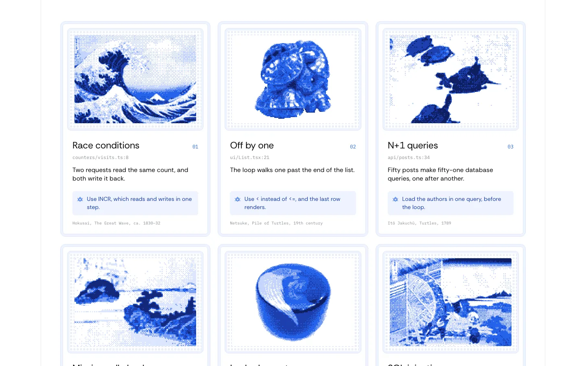
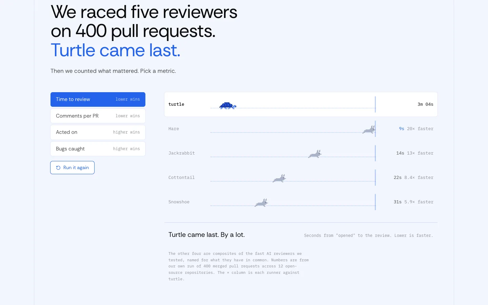
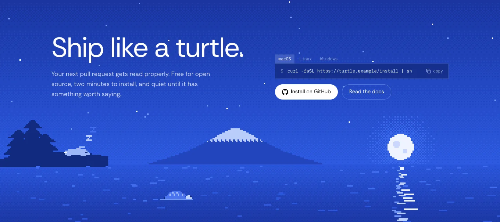

<div align="center">

<a href="https://turtle.kiraa-7e4.workers.dev">
  <picture>
    <source media="(prefers-color-scheme: dark)" srcset="https://ascii.rest/banner/turtle.dark.svg?color=6f97f2,c3d4fb&tagline=slow%20and%20steady%20merges%20the%20race">
    
  </picture>
</a>

<br>
<br>

<a href="https://turtle.kiraa-7e4.workers.dev"></a>

<br>

The landing page for turtle: a code reviewer that reads the whole repository before it says a word.<br>
React, Tailwind and canvas, with Japanese prints from The Met in blue pixels.

[live site](https://turtle.kiraa-7e4.workers.dev) · [run it](#run-it) · [what's on the page](#whats-on-the-page) · [the art](#the-art) · [how it's built](#how-its-built) · [contributing](CONTRIBUTING.md)

[](https://github.com/bas3line)
[](https://github.com/bas3line/turtle/actions/workflows/ci.yml)
[](LICENSE)
[](tsconfig.app.json)
[](package.json)
[](wrangler.jsonc)

</div>

<br>

Written in TypeScript by [@bas3line](https://github.com/bas3line). One page that makes the case for the slow reviewer: a Hiroshige print in 130 blue pixels with a loupe that shows what is really there, a review played out minute by minute as you scroll, a race the turtle loses on speed and wins on everything else, and a night sea where the hare sleeps and the turtle keeps swimming. No UI kit, no animation library: the art is canvas, SVG and CSS, and every museum image is public domain.

<p align="center">
  
  
</p>
<p align="center">
  
  
</p>

## Why

Most AI code reviewers sell speed: a review in seconds, a comment on every line. turtle's pitch is the opposite, and the oldest story about that is the tortoise and the hare. So the page is built out of the fable: the turtle against the hares in the benchmark, the hare asleep in the footer, and turtles from two hundred years of Japanese prints and carvings, reprinted in the pixel blues of a code tool.

## Run it

```sh
git clone https://github.com/bas3line/turtle
cd turtle
npm install
npm run dev        # http://localhost:5180
```

Node 20 or later.

| script | |
| --- | --- |
| `npm run dev` | the page with hot reload |
| `npm run check` | typecheck, lint and a production build; what CI runs |
| `npm run build` | the production build in `dist/` |
| `npm run preview` | the build, served by Wrangler the way Cloudflare will serve it |
| `npm run deploy` | build, then deploy to your own Cloudflare account |

It deploys as a [Cloudflare Worker with static assets](https://developers.cloudflare.com/workers/static-assets/) (`wrangler.jsonc`). Anything that serves a folder works too: `dist/` is plain HTML, CSS, JS and images.

## What's on the page

| section | what it does | file |
| --- | --- | --- |
| Nav | a flat bar that lifts into a floating pill with a pale blue rim once the page moves | `Nav.tsx` |
| Hero | a try-it box: paste a pull request, pick Review, Explain or Summarize, and watch the steps turtle takes before its answer | `Hero.tsx` |
| Hero art | Hiroshige's turtle as 130 pixels of blue that develop in dither order; the loupe shows the print at full resolution, drifts over the turtle by itself and follows the pointer | `HeroArt.tsx` |
| How it works | three cards with drawings in dots: the repository lighting up outward from the change, a diff read line by line until it stops at the bug, the checks passing and the stamp coming down | `HowItWorks.tsx`, `Dots.tsx` |
| A review | on a laptop the section pins and scrolling slides six moments of one review, 0:00 to 3:04, past a pixel turtle walking the track; a swipe on a phone | `Review.tsx` |
| What it catches | six kinds of bug, each on a Met print in blue pixels, with the file, what breaks and the fix | `Catches.tsx` |
| Benchmarks | the turtle against four hares on dotted lanes; pick a metric and they race again. On time the hares win by a mile; on comments, fixes and bugs caught it's the turtle's race | `Race.tsx`, `Sprites.tsx` |
| Setup | three steps, and a pace control: hare, steady or careful redraws how far turtle reads from the change and the files, time and comments that follow | `Setup.tsx` |
| Pricing | a seat calculator, and the comments your team would read in a month as two fields of squares, a big grey one and a small blue one | `Pricing.tsx` |
| FAQ | six questions, answered slowly | `Faq.tsx` |
| Footer | a pixel night scene drawn live: the moon over the sea, Fuji, the hare asleep under the pines, and the turtle taking four minutes to swim across. Then an install line with a copy button, the name in dots that brighten under the pointer, and a status line | `Footer.tsx`, `Scene.tsx` |

Everything that moves on its own holds still for anyone who prefers reduced motion.

turtle isn't a real product. Its numbers, prices, teams and benchmark are placeholders, and the install commands point at the reserved `.example` domain, so copying one can't fetch or run anything. The design is the point of this repository.

## The art

Every image is public domain, from [The Metropolitan Museum of Art's Open Access](https://www.metmuseum.org/about-the-met/policies-and-documents/open-access) collection, released under [CC0](https://creativecommons.org/publicdomain/zero/1.0/).

| image | where | source |
| --- | --- | --- |
| Utagawa Hiroshige, *Mannen Bridge, Fukagawa*, 1858 | hero | [The Met 37316](https://www.metmuseum.org/art/collection/search/37316) |
| Katsushika Hokusai, *Under the Wave off Kanagawa* (The Great Wave), ca. 1830–32 | race conditions | [The Met 45434](https://www.metmuseum.org/art/collection/search/45434) |
| *Netsuke in the Shape of a Pile of Turtles*, 19th century | off by one | [The Met 59608](https://www.metmuseum.org/art/collection/search/59608) |
| Itō Jakuchū, *Turtles*, 1789 | N+1 queries | [The Met 77205](https://www.metmuseum.org/art/collection/search/77205) |
| Ryūryūkyo Shinsai, *Turtle Island and Fujiyama*, 19th century | missing null checks | [The Met 54518](https://www.metmuseum.org/art/collection/search/54518) |
| Shibata Zeshin, *Tea Caddy with Design of Turtle*, 19th century | leaked secrets | [The Met 58346](https://www.metmuseum.org/art/collection/search/58346) |
| Katsushika Hokusai, *The Waterwheel at Onden*, ca. 1830–32 | SQL injection | [The Met 37322](https://www.metmuseum.org/art/collection/search/37322) |

How they were made: each print was cropped, cleaned of its paper grain with a median filter, and posterized with NumPy into six of the page's blues, with a 4×4 ordered dither where one blue meets the next. The results are 90 to 170 pixels wide and a few kilobytes each; the browser scales them up with `image-rendering: pixelated`. The netsuke and the tea caddy were photographed on a grey backdrop, so they were cut out of it first and stand on white. The hero's loupe reads from a second copy of the Hiroshige at full resolution, graded through the same blues.

The turtle and hare sprites are drawn by hand, pixel by pixel, in `cast.ts`. The footer scene isn't an image at all: `Scene.tsx` paints the sky, moon, Fuji, pines and sea in big pixels, four screen pixels to one, and animates the stars, waves and swimmers on top.

## How it's built

```
src/
  App.tsx            the page, top to bottom
  index.css          the palette (white, ink, one blue) as Tailwind tokens, and the frame and well classes
  site/
    hooks.ts         useMedia, useReducedMotion, useInView
    shared.tsx       the wordmark, buttons, section heads, and Band, the framed column
    Seal.tsx         the dot-turtle mark and the approval stamp
    Dots.tsx         dotted outlines, dot-filled blocks and labels, for the card drawings (SVG)
    cast.ts          the pixel turtle and hares, two frames each
    Sprites.tsx      draws a sprite and walks it
    HeroArt.tsx      the hero print in pixels, with the loupe (canvas)
    Scene.tsx        the night sea in the footer (canvas)
    ...              one file per section
public/art/px/       the museum images, posterized
```

React 19, Tailwind CSS 4, TypeScript, Vite. Three runtime dependencies: React, React DOM, and [lucide](https://lucide.dev) for a handful of icons. The art is plain canvas 2D and SVG: no WebGL, no animation library, and the whole `public/art` folder is about 300 KB.

## Contributing

Fixes and ideas are welcome. [CONTRIBUTING.md](CONTRIBUTING.md) covers the setup, the checks, the rules the page follows and how to open a pull request, and the [code of conduct](CODE_OF_CONDUCT.md) applies everywhere. Found a security problem? See [SECURITY.md](SECURITY.md).

## Author

Made by [@bas3line](https://github.com/bas3line). If you use it, a link back is appreciated, and so is a star.

To support it: [GitHub Sponsors](https://github.com/sponsors/bas3line), [Buy Me a Coffee](https://buymeacoffee.com/bas3line) or [PayPal](https://paypal.me/ShubhamYadav886).

## License

The code is MIT, © [@bas3line](https://github.com/bas3line). The museum images are public domain (CC0, The Met).
